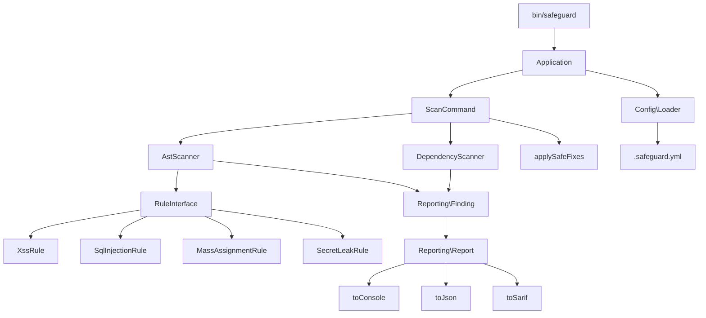

<!-- header:start -->
<div align="center">



<a href="#-quick-start"></a>

<a href="LICENSE"></a>

<a href="https://github.com/ajendras/php-safeguard/stargazers"></a>
<a href="https://github.com/ajendras/php-safeguard/actions/workflows/ci.yml"></a>

<a href="CONTRIBUTING.md"></a>

**Fast static security scanner for PHP and Laravel that finds OWASP issues, suggests fixes, and auto-hardens apps**

[✨ Features](#-features) • [⚡ Quick start](#-quick-start) • [🧰 Usage](#-usage) • [🧩 Architecture](#-architecture) • [📍 Roadmap](#-roadmap) • [🤝 Contributing](#-contributing)

</div>
<!-- header:end -->

## ✨ Why PHP Safeguard?

PHP web apps remain prime targets for injection and misconfiguration attacks, yet most teams only run security checks during audits. Existing scanners are either Java-based, outdated, or lack Laravel-specific intelligence. **PHP Safeguard** delivers a focused, dependency-light CLI that integrates into every developer workflow and CI pipeline.

- **Fast AST-based analysis** powered by `nikic/php-parser` that catches unsanitized sinks for XSS, SQLi, and more
- **Laravel-aware rules** via `MassAssignmentRule`, validation, and route-model-binding checks that plain PHP scanners miss
- **Dependency auditing** with `DependencyScanner` that queries the GitHub Advisory Database using real `composer.lock` data
- **Safe auto-fix** (`--fix`) that adds security headers, wraps output with `htmlspecialchars`, converts SQL queries to prepared statements, and upgrades mass-assignment calls to use validated input using conservative pattern matching
- **CI-ready** with configurable severity thresholds, SARIF output, and non-zero exit codes on high-severity findings

## 🎬 Demo

<p align="center"></p>

## 🚀 Features

<table>
<tr>
<td>🔍 <b>AST Analysis</b><br>Traverses PHP files with <code>AstScanner</code> and <code>NodeVisitor</code> to apply <code>XssRule</code>, <code>SqlInjectionRule</code> and more</td>
<td>📦 <b>Dependency Audit</b><br><code>DependencyScanner</code> reads <code>composer.lock</code> and checks the GitHub Advisory Database via Guzzle</td>
<td>🛡️ <b>Laravel Rules</b><br><code>MassAssignmentRule</code> detects <code>fill($request->all())</code>, missing guarded properties, and unsafe model calls</td>
<td>🔑 <b>Secret Detection</b><br><code>SecretLeakRule</code> with entropy calculation and service-specific regexes for API keys, tokens, passwords</td>
</tr>
<tr>
<td>📊 <b>Rich Reports</b><br><code>Report</code> class outputs color-coded console, JSON, or SARIF with line numbers, snippets, and remediation suggestions</td>
<td>🛠️ <b>Safe Auto-Fix</b><br><code>--fix</code> automatically adds security headers, applies <code>htmlspecialchars</code>, converts queries to prepared statements, and upgrades to validated() input using conservative regex replacements</td>
<td>⚙️ <b>YAML Config</b><br><code>Loader</code> parses <code>.safeguard.yml</code> with rule toggles, severity thresholds, and Laravel auto-detection</td>
</tr>
<tr>
<td>🚀 <b>CI Optimized</b><br><code>ScanCommand</code> returns non-zero exit codes based on <code>severity.minimum</code>; perfect for GitHub Actions</td>
<td>📏 <b>Severity Scoring</b><br>CVSS-inspired levels with <code>ignore</code> list support and configurable minimum thresholds</td>
</tr>
</table>

## 📦 Installation

Requires **PHP 8.2+**. All dependencies (`symfony/console`, `nikic/php-parser`, `guzzlehttp/guzzle`, `symfony/yaml`) are declared in `composer.json`.

```bash
composer global require php-safeguard/php-safeguard
```

The `bin/safeguard` executable will be available in your PATH. Verify with:

```bash
safeguard --version
```

## ⚡ Quick start

```bash
# Initialize a project-specific config (auto-detects Laravel)
safeguard init

# Scan the current directory (default command)
safeguard scan

# Scan with auto-fix and JSON output
safeguard scan --fix --format=json --path=examples/vulnerable-app
```

The included `examples/vulnerable-app/index.php` contains intentional XSS, SQL injection, and mass-assignment issues that will be reported immediately.

## 🧰 Usage

Run a full scan with progress and console output (the default):

```bash
safeguard scan
```

Scan a specific directory and request SARIF for GitHub Advanced Security:

```bash
safeguard scan --path=src --format=sarif > results.sarif
```

Initialize (or overwrite) a configuration file with sensible defaults and Laravel detection:

```bash
safeguard init --force
```

Apply safe automatic fixes for XSS, SQLi, validation and missing headers:

```bash
safeguard scan --fix
```

<details><summary>Advanced: Custom rule configuration and CI usage</summary>

Create a minimal `.safeguard.yml`:

```yaml
rules:
  xss: true
  sql-injection: true
  mass-assignment: true
  secret-leak: true
severity:
  minimum: high
auto-fix:
  enabled: true
  headers: true
  escape-output: true
  prepared-statements: true
  validation-rules: true
report:
  format: console
  show-snippets: true
ignore:
  - "examples/vulnerable-app/index.php:42"
```

In CI you can force JSON output and fail the build on any medium-or-higher finding:

```yaml
- name: PHP Safeguard
  run: safeguard scan --format=json --no-progress
```

The `ScanCommand` uses `calculateExitCode()` based on `SEVERITY_ORDER` and the configured `severity.minimum`.

</details>

## 🔧 Configuration

PHP Safeguard reads `.safeguard.yml` (or falls back to `Loader::DEFAULT_CONFIG`). All values shown below are declared in `InitCommand::buildDefaultConfig()` and `Loader`.

| Option                        | Default     | Description |
|-------------------------------|-------------|-------------|
| `rules.xss`                   | `true`      | Enable `XssRule` for unsanitized `echo`/`print` |
| `rules.sql-injection`         | `true`      | Enable `SqlInjectionRule` for `DB::raw()` and concatenation |
| `rules.mass-assignment`       | `true` (Laravel) | Enable `MassAssignmentRule` for `fill()`/`create()` with tainted input |
| `rules.secret-leak`           | `true`      | Enable `SecretLeakRule` using entropy + regex for detecting secrets |
| `severity.minimum`            | `medium`    | Minimum severity that will cause non-zero exit (`low`/`medium`/`high`/`critical`) |
| `auto-fix.enabled`            | `true`      | Whether `--fix` should run (also respects the CLI flag) |
| `auto-fix.headers`            | `true`      | Add `X-Frame-Options`, `Strict-Transport-Security` etc. to entry files |
| `auto-fix.escape-output`      | `true`      | Wrap obvious `echo` of variables with `htmlspecialchars` |
| `auto-fix.prepared-statements`| `true`      | Convert unsafe SQL string concatenation into parameterized prepared statements |
| `auto-fix.validation-rules`   | `true`      | Upgrade `$request->all()` to `$request->validated()` in mass-assignment calls |
| `report.format`               | `console`   | Output format used by `Report` (`console`/`json`/`sarif`) |
| `report.show-snippets`        | `true`      | Include offending code line in console reports |
| `ignore`                      | `[]`        | List of `file:line` patterns to suppress |

## 🧩 Architecture



The core flow begins in `Application` which bootstraps Symfony Console, loads configuration via `Loader` (with Laravel auto-detection), and registers `ScanCommand` as the default. `ScanCommand` orchestrates `AstScanner` (which parses files with `nikic/php-parser` and applies all enabled `RuleInterface` implementations) and `DependencyScanner`, aggregates `Finding` objects, then hands them to an immutable `Report` for output. Safe fixes are applied last if enabled.

## 📁 Project structure

```text
.
├── bin/safeguard                    # Entrypoint that instantiates Application
├── composer.json                    # Declares symfony/console, nikic/php-parser, guzzle, symfony/yaml
├── src/
│   ├── Application.php              # Bootstraps Symfony Console, registers commands & config
│   ├── Context.php                  # Context DTO passed to RuleInterface::detect()
│   ├── Commands/
│   │   ├── InitCommand.php          # Creates .safeguard.yml with Laravel detection
│   │   └── ScanCommand.php          # Orchestrates scanners, handles --fix/--format, exit codes
│   ├── Config/
│   │   └── Loader.php               # Parses YAML or returns defaults with validation
│   ├── Rules/
│   │   ├── RuleInterface.php        # detect(Node, Context): ?Finding contract
│   │   ├── XssRule.php              # Detects unsafe echo/print/concat
│   │   ├── SqlInjectionRule.php     # Flags DB::raw(), query() with concatenation
│   │   ├── SecretLeakRule.php       # Entropy + regex based secret leak detection
│   │   └── Laravel/
│   │       └── MassAssignmentRule.php # Detects fill($request->all()) etc.
│   ├── Scanners/
│   │   ├── AstScanner.php           # Recursive directory scan + AST traversal
│   │   └── DependencyScanner.php    # composer.lock + GitHub Advisory API
│   └── Reporting/
│       ├── Finding.php              # Immutable DTO for a detected security issue
│       └── Report.php               # Immutable report with toConsole(), toJson(), toSarif()
├── tests/
│   └── Unit/
│       └── AstScannerTest.php       # Tests XssRule, SqlInjectionRule, MassAssignmentRule on fixtures
└── examples/
    └── vulnerable-app/
        └── index.php                # Demo file with intentional vulnerabilities
```

## 🧪 Testing

```bash
composer test
# or
vendor/bin/phpunit
```

The test suite (`AstScannerTest`) covers AST parsing, rule detection for `XssRule`, `SqlInjectionRule`, `MassAssignmentRule` and the new `SecretLeakRule` using temporary PHP fixture snippets, edge cases (safe equivalents, parse errors), and the full scanner pipeline.

## 📍 Roadmap
<!-- roadmap:start -->
- [x] **v0.1.0** — first release: AST Analysis, Dependency Audit, Laravel Rules, Rich Reports
- [x] Integrate OpenAI to generate plain-English explanations and concrete fix patches for each finding
- [x] Add SARIF output for native GitHub Advanced Security code scanning upload
- [x] Implement safe automatic patching for htmlspecialchars, prepared statements, and validation rules
- [ ] Build official GitHub Action with matrix support for PHP 8.1-8.3 and Laravel 10/11
- [ ] Create curated database of Laravel-specific security advisories and config checks
- [ ] Support custom rules defined in YAML using simple expression language
- [ ] Add PHPStan extension that reuses the same rule set for IDE integration
- [ ] Optimize AST traversal with caching for large monorepos (>500 files)
- [ ] Include WordPress plugin scanning profile for common insecure themes and plugins
- [ ] Provide HTML dashboard with interactive findings treemap and trend graphs
- [x] Add secret-leak detection (API keys, passwords) using entropy + regex rules

> 🤖 This roadmap is worked through continuously — ideas and PRs welcome!
<!-- roadmap:end -->

## 🤝 Contributing

We love community contributions! Whether it's a new rule, a bug fix, improved docs, or a Laravel-specific detection, please join in.

See [CONTRIBUTING.md](https://github.com/php-safeguard/php-safeguard/blob/main/CONTRIBUTING.md) and our [CODE_OF_CONDUCT.md](https://github.com/php-safeguard/php-safeguard/blob/main/CODE_OF_CONDUCT.md). Good-first-issue PRs are especially welcome — just open a PR against the `main` branch.

## 📄 License

This project is licensed under the **MIT License** — see the [LICENSE](https://github.com/php-safeguard/php-safeguard/blob/main/LICENSE) file for details.

<!-- footer:start -->
<div align="center">

### ⭐ Star history

<a href="https://star-history.com/#ajendras/php-safeguard&Date"></a>

If **PHP Safeguard** saves you time, a ⭐ helps others find it.

Made with ❤️ by [Ajendra](https://ajendra.info)


</div>
<!-- footer:end -->
